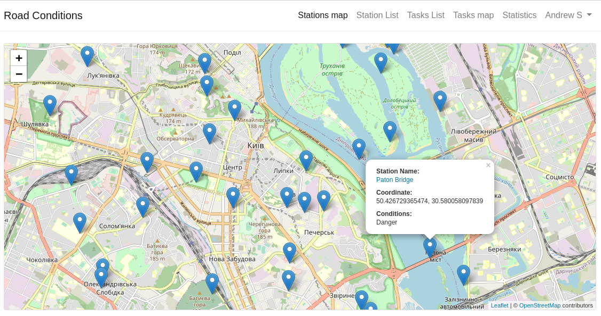
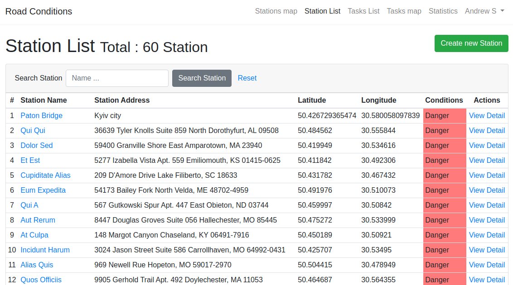
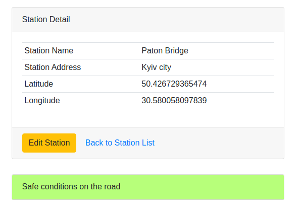
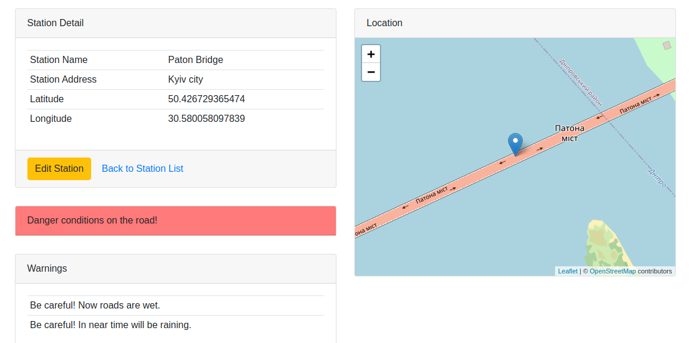
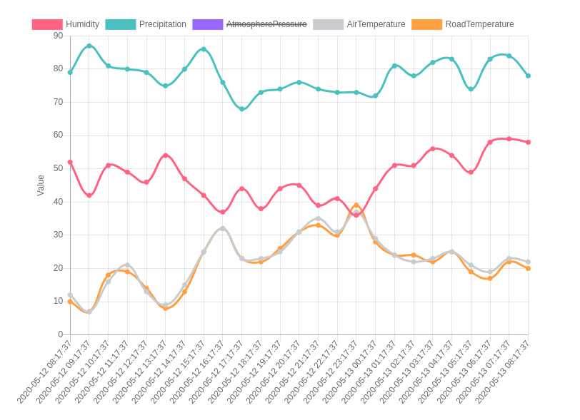
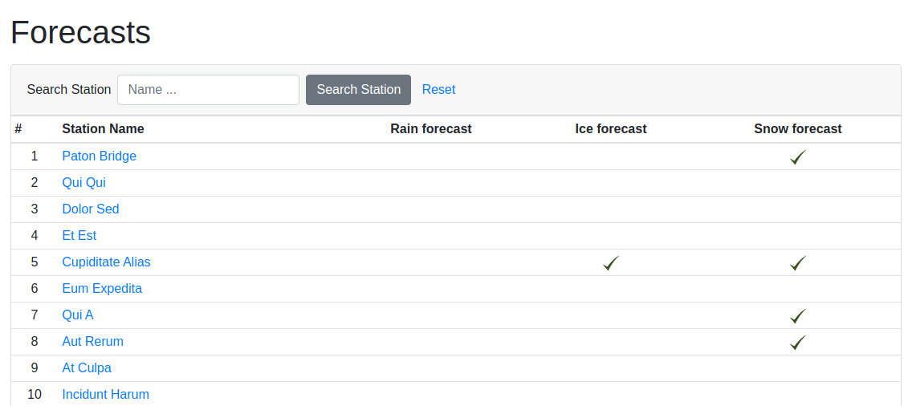

## About the Project

This repository contains the web-based component of a larger hardware-software system designed for monitoring road conditions. While the full system includes sensors and data collection hardware, this project focuses solely on the software interface, which receives data from sensors via API and provides users with interactive visualizations, metrics, warnings, and forecasts.

The project was developed as part of a university coursework, demonstrating how to manage and display environmental data in a real-time web application.

---

## Features

* **Map of agents**
  Visualize all monitoring agents on an interactive map. Each agent shows its current status and location.
  
  

* **List of agents**
  View all monitoring agents in a structured list with essential details for quick overview.

  

* **Agent / Station details**
  Click on an agent to see detailed information, including name, address, coordinates, and current road conditions.

  

* **Warnings for dangerous conditions**
  Agents highlight potentially hazardous conditions such as rain, fog, or other adverse weather.

  

* **Metrics charts**
  Track changes in various metrics over time, such as humidity or other environmental indicators.

  

* **Forecasts**
  Access predicted road conditions to plan ahead. This feature provides an outlook on future environmental conditions.

  
